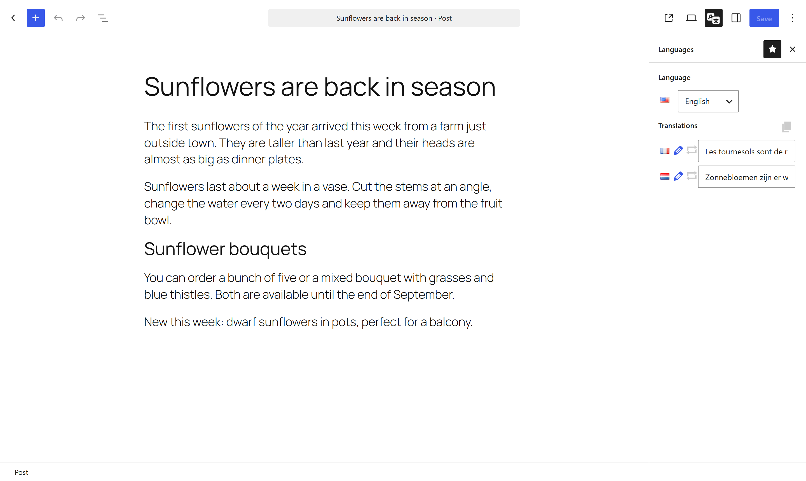

# Strope Translate

The most comprehensive free translation plugin for WordPress.

Run your site in as many languages as you like, with private machine translation that runs in your own browser.

## Highlights

- Translate posts, pages, media, categories, tags, custom post types and taxonomies, template parts, patterns and navigation.
- Language from the URL directory, a sub-domain or a domain per language.
- Block editor sidebar, language switcher blocks, a floating switcher and an "Also available in" notice.
- Translation status: missing, outdated and not yet reviewed translations, with the words left to translate.
- Edit translations on the front end, in place.
- Translator role, per-user languages and translation jobs.
- Optional machine translation without a translation service: [Bergamot](https://github.com/mozilla/translations), the engine of Firefox Translations, runs in your editors' browsers, so your text never leaves your site.
- Translate any string of the active theme and plugins, without editing .po files.
- WooCommerce, ACF, Yoast SEO and more; a WPML API layer and an optional Polylang (`pll_*()`) compatibility layer.
- One-click import of an existing Polylang site.

The full feature list, FAQ and external services are in [readme.txt](readme.txt).

## Requirements

- WordPress 6.5 or later
- PHP 7.4 or later

## Installation

Install it from the WordPress plugin directory, or download the zip from the [releases](../../releases) and upload it in Plugins > Add New. The setup wizard opens when the plugin is activated.

## Development

The built assets and the Composer autoloader are committed, so a checkout works as a plugin as it is. To change the scripts or styles, run the tests or build the release zip, see [DEVELOPMENT.md](DEVELOPMENT.md).

## Credits and licence

Strope Translate is a fork of [Polylang](https://wordpress.org/plugins/polylang/) by WP SYNTEX and Frédéric Demarle, and is released under the same licence, the [GPL v3 or later](LICENSE). It is not affiliated with or endorsed by WP SYNTEX. The notices of the bundled third-party code are in [THIRD-PARTY-NOTICES.txt](THIRD-PARTY-NOTICES.txt).

Made by [Strope](https://strope.io/).
